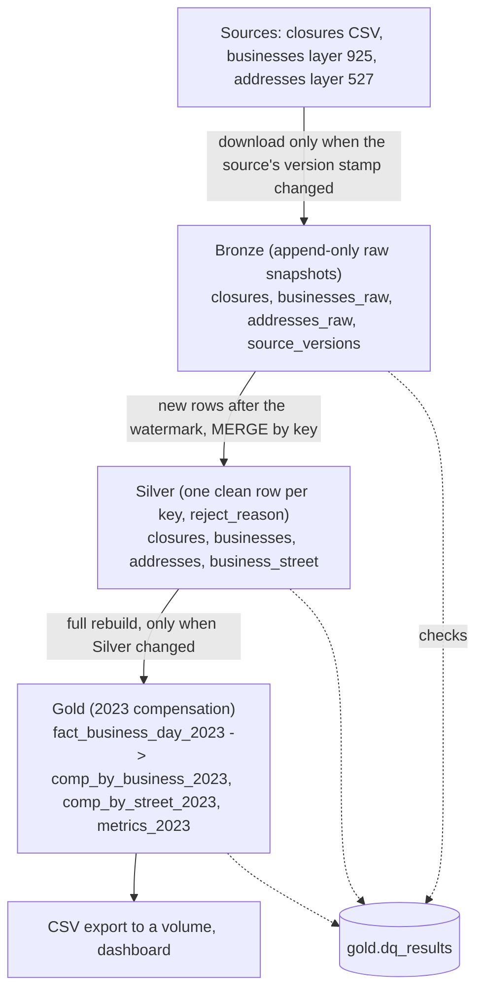

# Tel Aviv street closures: 2023 business compensation pipeline

A PySpark / Delta pipeline on Databricks (Free Edition, serverless) that computes how much the municipality owes businesses for street closures in 2023,
from two public sources: the street-closures CSV and the city's businesses layer (ArcGIS API). Medallion layout: Bronze (raw snapshots), Silver (clean, merged by key), Gold (compensation).



## Repository layout

| path | what it is |
|---|---|
| `Notebooks/00_setup.py` | shared names, `run_id`, and the helpers used by every layer (`append_rows`, `latest_per_key`, `upsert_rows`, `log_check`, `normalize_street`) |
| `Notebooks/01_bronze.py` | downloads the three sources when their version stamp changed and appends them as raw snapshots |
| `Notebooks/02_silver.py` | reads new Bronze rows, cleans and types them, merges by key, builds the business-to-street lookup |
| `Notebooks/03_gold.py` | rebuilds the compensation tables when Silver changed; fails the run if a check fails |
| `Notebooks/04_export.py` | writes the cleaned Silver tables and the Gold outputs as CSV files to the volume `tlv.gold.export` |
| `tests/` | pytest unit tests of the `00_setup` helpers (street key, compensation rule, latest-per-key, MERGE) on a local Spark |
| `requirements-dev.txt` | what the tests need locally (`pip install -r requirements-dev.txt`, then `pytest`) |
| `sql/data_checks.sql` | eight independent SQL checks on the result (totals, duplicates, outliers) |
| `sql/street_match_comparison.sql` | validation of the street matching: by name vs. by nearest address |
| `dashboard/tlv_compensation_2023.lvdash.json` | Databricks dashboard (import it: Dashboards -> Create -> Import from file) |
| `dashboard/dashboard_queries.sql` | the dashboard's datasets as plain SQL |
| `job/tlv_compensation_daily.job.yml` | the daily job, Bronze -> Silver -> Gold -> Export, 07:00 Asia/Jerusalem (Jobs -> Create -> Edit as YAML) |
| `docs/assignment.txt` | the assignment text |

## How to run

1. Clone this repository into Databricks as a Git folder (Workspace -> Create -> Git folder -> repository URL).
2. Open `Notebooks/00_setup.py`. The catalog name is `tlv`; if your workspace does not allow creating catalogs, change `CATALOG` to `workspace`. Nothing else is configured.
3. Run the notebooks in order: `01_bronze`, `02_silver`, `03_gold`, `04_export` (each starts with `%run ./00_setup`). The first run downloads everything (about 2 minutes on serverless) and creates all tables; the export lands in Catalog -> tlv -> gold -> Volumes -> export.
4. Run `03_gold` again: it prints that Silver has not changed and stops. Run `01_bronze` again: it prints `unchanged, download skipped` per source. Section "What a second run prints" below shows the expected output.
5. Daily schedule: Jobs & Pipelines -> Create -> Job -> Edit as YAML -> paste `job/tlv_compensation_daily.job.yml`, replace the folder part of the four notebook paths with your Git folder path, Save, Run now.
6. Dashboard: Dashboards -> Create -> Import from file -> `dashboard/tlv_compensation_2023.lvdash.json`. It reads `tlv.gold.*`.
7. Checks: run `sql/data_checks.sql` in the SQL editor; every query states the expected result in its comment. Every run also writes its own checks to `tlv.gold.dq_results`, and `03_gold` stops with an error if one of its checks fails.
8. Unit tests (local machine, Python 3.10+ and Java 17): `pip install -r requirements-dev.txt` then `pytest`. The tests load the helpers from `Notebooks/00_setup.py` and run them on a local Spark with Delta.

### What a second run prints
Nothing changed at the sources, so nothing is downloaded, merged or rebuilt; each layer says so and records it in `dq_results`:
```
01_bronze   closures: unchanged, download skipped
            businesses: unchanged, download skipped
            addresses: unchanged, download skipped
02_silver   closures: processed 0 bronze rows -> silver +0 ~0
            businesses: processed 0 bronze rows -> silver +0 ~0, rejected 0, dedup in batch 0, no id 0
03_gold     gold not rebuilt: Silver has not changed since the last build
```

## Tables

**Bronze** (`tlv.bronze`, append-only, every column as text or JSON)

| table | one row is | key |
|---|---|---|
| `closures` | one CSV line per download | `ID` + `run_id` |
| `businesses_raw` | one API feature (JSON) per download | `objectid` + `run_id` |
| `addresses_raw` | one city address feature (JSON) per download | `objectid` + `run_id` |
| `source_versions` | one download: source name, version stamp, run, time | |

**Silver** (`tlv.silver`, typed, merged by key, `reject_reason` NULL = valid)

| table | one row is | key | notes |
|---|---|---|---|
| `closures` | one side (from / to) of one closure event | `id_rechov`, `side` | dates, `street_code`, `is_pedestrian_street`, `reject_reason` |
| `businesses` | one business, latest record | `business_id` | `area`, `founded_at`, `x`, `y`, `reject_reason` |
| `addresses` | one city address | `address_id` | `street_code`, `street_name`, `house_number`, `x`, `y` |
| `business_street` | one business and its street code | `business_id` | `match_method` = by_name / by_point / unmatched; rebuilt every run |

**Gold** (`tlv.gold`, rebuilt when Silver changed)

| table | one row is | main columns |
|---|---|---|
| `closure_days_2023` | one street and one day it was closed in 2023 | `street_code`, `day`, `closures_that_day` |
| `dim_business` | one valid business with its street code | `business_id`, `street_code`, `match_method`, `area`, `founded_date` |
| `fact_business_day_2023` | one business and one compensated day | `daily_comp`, `daily_comp_uncapped`, `hit_cap` |
| `comp_by_business_2023` | annual total per business (deliverable 1) | `compensated_days`, `total_comp_ils`, `days_at_cap` |
| `comp_by_street_2023` | annual total per street (deliverable 2) | `businesses`, `closure_days`, `total_comp_ils` |
| `metrics_2023` | one metric per row | `total_compensation_ils`, `cost_per_area_unit_ils`, `share_of_days_at_cap`, ... |
| `dq_results` | one check of one run, every layer | `run_id`, `layer`, `check_name`, `value`, `passed` |
| `build_log` | one Gold build and the Silver stamp it used | `run_id`, `silver_stamp`, `built_at` |

## Assumptions and decisions
1. Compensation is calculated only for days in 2023.
2. `shetach` is taken from the API as is (an integer), 100 ILS per unit per day, capped at 10,000 ILS per business per day.
3. A business is matched to a closure by street code. The businesses API carries only a street name, so the code comes from the city addresses layer (ArcGIS layer 527, 52,165 addresses with street code, street name, house number and coordinates): first by normalized street name, and when no address carries that name, by the address that sits on the same point as the business (coordinates rounded to 1 m; the city snaps business points onto its address points, see the validation below). Businesses that match neither way are counted in `dq_results` and receive no compensation. Both sources use the same street codes (checked on 7 codes from the closures file). Validation (`street_match_comparison.sql`, 17.11.2026): resolving the code by name and by nearest address independently gives the same code for 98.7% of businesses (36,867); the average distance from a business point to its nearest address point is 0.1 m, so business coordinates are snapped to the city address points. 156 businesses (0.4%) get different codes from the two methods, 125 have a name but no address within 50 m, 196 have an address but an unknown name, 26 have neither.
4. Each closure row names two streets; both are treated as affected. Streets located between the two named streets are not included: the assignment does not define them and the data gives no way to identify them. `id_rechov` is used only as the row identifier.
5. Every day in a closure range is an eligible day.
6. Businesses founded after 2023 are excluded (in Gold). A business founded during 2023 is eligible only from its founding date (`tr_hakama`) onward.
7. Bronze is append-only and downloads a source only when a new version was published. Each source has a version stamp that changes only when the publisher replaces the data: for the CSV it is the file's `Last-Modified` header (one HEAD request, no download); for an ArcGIS layer it is the `date_import` column, the date the city loaded the layer, which is identical on every row because the city always reloads the whole layer, so one distinct-values query returns that single value. After each download the stamp is saved in `bronze.source_versions`. On the next run the current stamp is compared with the saved one: equal means skip (recorded in `dq_results` as `bronze_<source>_skipped_unchanged`), different means download. A changed source is downloaded in full and appended as a new snapshot tagged with `run_id` and `ingested_at`; nothing in Bronze is updated or deleted. The source offers no per-record change date, so record-level incremental extraction is not possible; the city reloads both layers often (both carried a 17.11.2026 stamp the morning after a 16.11 run). Silver reads the rows ingested after its watermark, keeps the latest snapshot per key, and merges by key (Delta MERGE: insert new keys, update changed records, leave identical ones untouched). Gold is rebuilt in full on every run: it covers one finished year whose data is corrected rather than grown (late closures, fixed dates, changed business attributes or rules), the fact is bounded by businesses on closed streets x 8,408 street-days (about 655K rows), and a rebuild applies inserts, updates and deletes from Silver in one step and is idempotent. The rebuild runs only when Silver changed: Gold compares the newest `processed_at` across the three Silver source tables with the stamp saved in `gold.build_log` by the last build, and on an unchanged Silver it records `gold_skipped_unchanged` in `dq_results` and stops.
8. Closures: `id_rechov` identifies the closure event (one value per closed segment and date range), not a street. 9 events appear twice in the file under different `ID`s and are kept once in Silver (lowest `ID`); the 334 sides whose street code is 0 (336 before the duplicate events are removed) carry no street information and are kept with `reject_reason = missing_street_code`, so Gold ignores them (203 events: 70 with one valid side that still counts, 133 with none; only 6 of the 203 touch 2023). Some of these rows name streets in the free-text remark column (for example "חסימה מרחוב פרישמן עד לרחוב אבן גבירול"); recovering a street code from that text against the city street table is a possible next step, not done here.
9. Gold is rebuilt from Silver as a whole (overwrite) whenever Silver changed, see 7. Compensation is computed on `fact_business_day_2023`, one row per business per compensated day, with `daily_comp = LEAST(area * 100, 10000)`.
10. Silver is loaded incrementally as well: each run processes only Bronze rows ingested after the highest `bronze_ingested_at` already in Silver, and merges them by key (closure x side; business id, latest `date_import` in the batch wins). Rows that fail validation stay in the same Silver table with a `reject_reason` (NULL = valid); Gold reads only valid rows, and a record that is fixed in the source simply gets its `reject_reason` cleared by the next MERGE. Designed this way so the pipeline keeps the same cost when the sources grow.

11. Permanent pedestrian streets are not compensated. Five closure events (`id_rechov` 2994, 2995, 2997, 2998, 2999; Herzl, Rothschild, Florentin, HaCarmel, HaYarkon and their paired streets) start in June 2020, carry the text "מדרחוב" (pedestrian street) in the free-text hours/remark columns (`shaot`, `sw_laila`) and cover most of 2023. They describe a permanent change of the street, not a closure that harms a business temporarily. Silver flags them with `is_pedestrian_street`, Gold excludes them, and `metrics_2023` reports how many events were excluded. Before this exclusion, these events alone produced about 2,450 of the 8,408 street-days of 2023 and most of the total compensation (6.2 billion ILS).

## Design decisions in one place
| decision | why | where |
|---|---|---|
| Bronze downloads only when the publisher's version stamp changed | the sources have no per-record change date; the stamp is the only change signal they offer, and one request answers it | `01_bronze` section 0, assumption 7 |
| `date_import` compared as text, with equality | the layer stores it as a string; the question is "same load or a new one", not "newer", so equality is enough and never misreads a date format | `01_bronze` section 0 |
| Silver keeps invalid rows with a `reject_reason` instead of a quarantine table | one table per entity to maintain; a record fixed at the source clears its own reason on the next MERGE | `02_silver`, assumption 10 |
| Street code by name, then by point | the businesses layer has no street code; the city snaps business points onto address points, so an exact point match is a safe second step | `02_silver` section 4, assumption 3 |
| Gold is rebuilt in full, but only when Silver changed | one finished year whose data is corrected rather than grown; a full rebuild applies inserts, updates and deletes in one idempotent step, and the stamp check makes the daily run free when nothing changed | `03_gold` section 0, assumption 7 |
| The compensation rule is one function in `00_setup` | `daily_compensation` is used by Gold and tested in `tests/`; the rate and cap are defined once | `00_setup` |
| A failed Gold check stops the run and the build is not recorded | the job turns red instead of publishing wrong numbers; the next run rebuilds | `03_gold` section 7 |

## Known limitations
1. Bronze downloads a changed source in full (about 37K businesses, 52K addresses); the sources offer no way to fetch only changed records.
2. The 334 closure sides without a street code (assumption 8) are not compensated; some name a street in free text that is not parsed.
3. Businesses whose street name is unknown to the city address layer and whose point sits on no address (26 in the 16.11 run) receive no compensation and are only counted.
4. Each notebook run has its own `run_id`, so in a job the four tasks write four ids per day to `dq_results`.
5. Street-closure rows name two streets; streets between them are not identified (assumption 4).

## Next steps for production
1. Alerting on the job (failure e-mail or Slack) and on `dq_results` rows with `passed = false`.
2. A CI step that runs `pytest` on every pull request.
3. Expected-schema checks on the API response before Bronze appends it, so a renamed field fails loudly.
4. Retention for Bronze snapshots (for example keep 90 days) once the history is no longer needed.

## Results 2023 (run of 16.11.2026, pedestrian streets excluded)
| metric | value |
|---|---|
| total compensation | 4,034,540,500 ILS |
| compensated businesses | 7,503 (26 businesses had no street code) |
| compensated business-days | 655,176 |
| average compensation per business | 537,723.64 ILS |
| cost per area unit | 783.07 ILS |
| share of business-days at the 10,000 cap | 34.8% |
| cap savings vs. uncapped | 17,180,234,000 ILS |
| streets closed on at least one day | 93 |
| pedestrian-street events excluded | 9 |

Top streets (`tlv.gold.comp_by_street_2023`):

| street | businesses | closure days | compensation (ILS) | share |
|---|---|---|---|---|
| Ibn Gvirol | 592 | 365 | 1,211,609,000 | 30.0% |
| Allenby | 518 | 331 | 946,746,000 | 23.5% |
| Herzl | 288 | 142 | 304,042,600 | 7.5% |
| Sde Yitzhak | 201 | 176 | 242,200,800 | 6.0% |
| Eilat | 154 | 179 | 219,447,000 | 5.4% |

## Insights
1. More than half of the 2023 compensation (53.5%) comes from two light-rail streets, Ibn Gvirol and Allenby: 1,110 businesses closed almost the whole year. The ten largest streets hold 85% of the total.
2. Long closures drive the bill: 78 closure events touch 2023, and 11 of them (over 90 days each, light rail and infrastructure works) account for 78% of all closure days.
3. The rate is only half the lever. Cutting it from 100 to 50 ILS per area unit lowers the bill by 30% (to 2.84 billion), not 50%, because many businesses are already at the 10,000 ILS daily cap; at 20 ILS the bill is 1.65 billion. Any policy change has to move the cap and the rate together.
4. 24.2.2023 shows a one-day spike of 71 closed streets: the Tel Aviv Marathon (44 one-day closures of type "ארוע מרתון" in the source).
5. Single licenses can carry very large areas (the central bus station holds 11 licenses with 361,365 area units in total), so the 10,000 ILS daily cap is what keeps the model bounded: without it the 2023 bill would be 21.2 billion ILS.
6. Public bodies are compensated like any business: the municipality itself (owner id 500250006) holds 123 licenses that receive 83,095,800 ILS (2.1%), and a keyword match on owner names (municipality, ministries, the State, the Electric Company, hospitals, universities) finds 496 licenses receiving 164,617,500 ILS, 4.1% of the total. Kept in the model: the rules say nothing about public bodies and the data has no reliable flag for them. This is a policy decision to raise, not one to make in the pipeline.
7. Data checks run on 16.11.2026 (`data_checks.sql`): the total recomputed directly from Silver in one SQL query equals the Gold total to the shekel (4,034,540,500); all 37,370 business ids reach Silver, none rejected; no duplicates at any grain; area is plausible (median 74, 90th percentile 624, one business with area 0, the ten largest are a farm, the Ministry of Defence, Ichilov hospital, the Electric Company and the central bus station, 41% of businesses are at or above the 100-unit cap threshold); 983 business ids (2.6%) share owner and address with another id, all with different areas, so they are distinct licenses in one complex, not duplicates.
8. Before excluding permanent pedestrian streets (assumption 11) the total was 6.2 billion ILS; five events from June 2020 added 2.2 billion.
