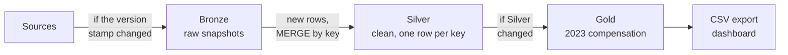

# Tel Aviv street closures: 2023 business compensation pipeline

This repository holds an incremental PySpark and Delta Lake pipeline on Databricks (Free Edition, serverless) that calculates the compensation the Tel Aviv-Yafo municipality owes businesses for street closures in 2023.
Sources: the street-closures CSV and the businesses and addresses layers of the municipality's ArcGIS API.
Medallion architecture: Bronze keeps raw snapshots, Silver holds clean records merged by key, and Gold holds the compensation tables behind the dashboard.



| layer | tables | runs when |
|---|---|---|
| Sources | closures CSV, businesses layer 925, addresses layer 527 | published by the Tel Aviv-Yafo municipality |
| Bronze | `closures`, `businesses_raw`, `addresses_raw`, `source_versions` | a source's version stamp changed |
| Silver | `closures`, `businesses`, `addresses`, `business_street` | Bronze has rows after the watermark |
| Gold | `fact_business_day_2023`, `comp_by_business_2023`, `comp_by_street_2023`, `metrics_2023`, `build_log` | Silver changed since the last build |
| Checks | `dq_results`, written by every layer on every run | always |

## Key results

Filled in from the final run (see [docs/results.md](docs/results.md)).

## If you have five minutes

1. [dashboard/dashboard.png](dashboard/dashboard.png): the headline numbers, top streets, closures per day.
2. `gold.metrics_2023` (or [docs/results.md](docs/results.md)): the two totals side by side, model A (the literal rule) and model B (permanent pedestrian streets excluded, used for the outputs), with cost per area unit and the share of days at the cap.
3. [docs/design.md](docs/design.md), assumption 11: why the pedestrian streets are excluded, and assumption 3: how a business gets its street code.
4. `Notebooks/03_gold.py`, sections 4 to 7: the fact table, the two outputs, the metrics and the checks that stop the run.
5. `tests/test_setup_helpers.py`: the five unit tests of the shared rules.

## Documentation

- [Design and assumptions](docs/design.md)
- [Tables](docs/tables.md)
- [Results and insights](docs/results.md)

## How to run

1. Clone this repository into Databricks as a Git folder (Workspace -> Create -> Git folder -> repository URL).
2. Open `Notebooks/00_setup.py`. The catalog name is `tlv`; if your workspace does not allow creating catalogs, change `CATALOG` to `workspace` (the default catalog every user can write to) and replace `tlv.` with `workspace.` in `sql/` and in the dashboard JSON. Nothing else is configured.
3. Run the notebooks in order: `01_bronze`, `02_silver`, `03_gold`, `04_export` (each starts with `%run ./00_setup`). The first run downloads everything (about 2 minutes on serverless) and creates all tables. The export lands in Catalog -> tlv -> gold -> Volumes -> export.
4. Run `03_gold` again: it prints that Silver has not changed and stops. Run `01_bronze` again: it prints `unchanged, download skipped` per source. Section "What a second run prints" below shows the expected output.
5. Daily schedule: Jobs & Pipelines -> Create -> Job -> Edit as YAML -> paste `job/tlv_compensation_daily.job.yml`, replace the folder part of the four notebook paths with your Git folder path, Save, Run now.
6. Dashboard: Dashboards -> Create -> Import from file -> `dashboard/tlv_compensation_2023.lvdash.json`. It reads `tlv.gold.*`. What it looks like: [dashboard/dashboard.png](dashboard/dashboard.png).
7. Checks: run `sql/data_checks.sql` in the SQL editor; every query states the expected result in its comment. Every run also writes its own checks to `tlv.gold.dq_results`, and `03_gold` stops with an error if one of its checks fails.
8. Unit tests (local machine, Python 3.10+ and Java 17): `pip install -r requirements-dev.txt` then `pytest`. The tests load the helpers from `Notebooks/00_setup.py` and run them on a local Spark with Delta.

### What a second run prints

Nothing changed at the sources, so nothing is downloaded, merged or rebuilt; each layer says so and records it in `dq_results`:
```
01_bronze   closures: unchanged, download skipped
            businesses: unchanged, download skipped
            addresses: unchanged, download skipped
02_silver   closures: processed 0 bronze rows -> silver +0 ~0
            businesses: processed 0 bronze rows -> silver +0 ~0, rejected 0, dedup in batch 0, no id 0
03_gold     gold not rebuilt: Silver has not changed since the last build
```

## Repository layout

| path | what it is |
|---|---|
| `Notebooks/00_setup.py` | shared names, `run_id`, and the helpers used by every layer (`normalize_street`, `daily_compensation`, `append_rows`, `latest_per_key`, `upsert_rows`, `log_check`) |
| `Notebooks/01_bronze.py` | downloads the three sources when their version stamp changed and appends them as raw snapshots |
| `Notebooks/02_silver.py` | reads new Bronze rows, cleans and types them, merges by key, builds the business-to-street lookup |
| `Notebooks/03_gold.py` | rebuilds the compensation tables when Silver changed; fails the run if a check fails |
| `Notebooks/04_export.py` | writes the cleaned Silver tables and the Gold outputs as CSV files to the volume `tlv.gold.export` |
| `tests/` | pytest unit tests of the `00_setup` helpers (street key, compensation rule, latest-per-key, MERGE) on a local Spark |
| `requirements-dev.txt` | what the tests need locally (`pip install -r requirements-dev.txt`, then `pytest`) |
| `sql/data_checks.sql` | eight independent SQL checks on the result (totals, duplicates, outliers) |
| `sql/street_match_comparison.sql` | validation of the street matching: by name vs. by nearest address |
| `dashboard/tlv_compensation_2023.lvdash.json` | Databricks dashboard (import it: Dashboards -> Create -> Import from file) |
| `dashboard/dashboard_queries.sql` | the dashboard's datasets as plain SQL |
| `dashboard/dashboard.png` | screenshot of the dashboard |
| `job/tlv_compensation_daily.job.yml` | the daily job, Bronze -> Silver -> Gold -> Export, 07:00 Asia/Jerusalem (Jobs -> Create -> Edit as YAML) |
| `docs/assignment.txt` | the assignment text |
| `docs/design.md` | assumptions, design decisions, known limitations, next steps |
| `docs/tables.md` | every table in Bronze, Silver and Gold: grain, key, main columns |
| `docs/results.md` | 2023 results, top streets, insights |
